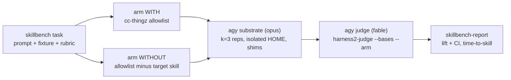

# skillbench: leave-one-out skill lift benchmark on an agy substrate

## Overview
- Measure how much each of the 18 cc-thingz skills (`<cc-thingz>/plugins/*/skills/*/SKILL.md`) improves task outcomes when run on AGY/Jetski (`agy`).
- Metric 1 — **outcome lift**: rubric fraction (`n_passed / n_criteria`, Harness² `Scored.frac`) of arm WITH (full cc-thingz suite) minus arm WITHOUT (same suite minus the target skill, leave-one-out), paired by task, with a 95% bootstrap CI and a verdict (`helps` / `hurts` / `inconclusive` / `insufficient data`).
- Metric 2 — **time-to-skill**: seconds from rollout start until the target `SKILL.md` is first read, plus invocation rate (WITH arm only).
- Integrates with Harness² as a new substrate (`agy`) and a new benchmark adapter (`skillbench`), using only reference ("base") executions; the Propose–Probe–Compose recursion stays untouched so it can be enabled later on the same tasks (Option B).
- Executor model: **opus**; judge model: **fable** — both via `agy`.
- **Statistical honesty**: with 4 tasks per skill the task-level bootstrap has only 35 distinct resamples, so only large lifts (roughly ≥ 0.2 of the rubric) will get a `helps`/`hurts` verdict; most skills are expected to land `inconclusive` in the first full run. The report states this next to the verdicts.
- **Done when**: a stub-backed end-to-end run and the paid pilot (3 skills) each produce `report.md` with lift + CI + verdict and time-to-skill per skill, without touching the user's real `$HOME`.

## Context (from discovery)
- **Harness² plug points**:
  - `harness2/substrate/base.py` — `Substrate` protocol: `surface / materialise(tree_dir, spec, ctx) / execute / read_trajectory / preflight`; existing impls `opencode.py`, `codex.py`; registry `harness2/substrate/__init__.py`.
  - `harness2/core/spec.py` — `BenchmarkAdapter` protocol, `BenchSpec` (requires proposer + selector channels; `BenchPrompts` text must not contain "rubric"/"score"), `ChannelSpec`, `INSTALL_MODES`.
  - `harness2/core/schedule.py` — `run_task` (line 566) reads `surface()` + `base_harness()` tree (617), rolls `k` bases (625), runs modes (635); `_resume` (371) re-runs anything not `status == "ok"`; `run_domain` (~716) counts only `ok`/`skipped` as done.
  - `harness2/cli/run_sweep.py` — hardcodes `tag=""` (168); `summary_namespace`, `library_root_for`, `_check_identity`, `--dry-run` printer called without tag; builds `Proposer(spec.channels["proposer"])`.
  - `harness2/cli/judge.py` — `config.validate_models(judge=True)` (165), `make_adapter` without arm, untagged `summary_namespace`, identity check against `config.JUDGE_MODEL` (170); `judge_bases` (124) calls `adapter.score(run_dir, task_id)`.
  - `harness2/cli/_common.py` — `BENCHES`, `SUBSTRATES`, `make_adapter(bench, subset, substrate, split_file)`, `--substrate` default `oc`.
  - `harness2/preflight.py` — `check()` runs opencode runner/pin/patch probes and maps bench → dependency repo with `{"jb","lab","wb"}[bench]` (58): **KeyError** for a new bench.
  - `harness2/cli/check.py` — hardcoded `--bench (jb, lab, wb)` / `--substrate (oc, cx)`.
  - `harness2/config.py` — `.env` loading, `env()`, `require()`, `validate_models()` (requires `HARNESS2_SOLVER_MODEL` / `HARNESS2_JUDGE_MODEL`).
- **agy headless invocation** (`~/projects/revmux/app/executor/agy.go`): `agy -p <prompt> --output-format stream-json --dangerously-skip-permissions --disable-slash-commands [--model M] [--effort E] [--json-schema S] --print-timeout <dur>`; events `{event, result{structured_output, usage.total_tokens}, step_update{step_type, state, tool_name, text_delta, tool_info{name, parameters}}}`. revmux hardcodes `ActualModel = "agy"` (line 180): stream-json most likely carries **no model field**, and agy can silently ignore `--model`.
- **Skill suite**: 18 `SKILL.md` in plugins brainstorm, planning, review, thinking-tools, workflow (+ `skill-eval` hook plugin). `plan-review` is an agent — out of scope.
  - `ask_question` users (8): brainstorm, exec, make-plan, dialectic, backlog, clarify, learn, wrong.
  - Side-effect skills: `git-review` and `make-plan` can open `$EDITOR` / revdiff / `plan-annotate.py`; `md-copy`, `txt-copy` write the clipboard (xclip/xsel/wl-copy/pbcopy).
- **Installed plugins** in `~/.gemini/config/plugins/` also include `revmux` (spawns nested agy runs), `googlecloudtools.datacloud_telemetry`, `agterm-ide-launcher` — must not be staged.
- **Environment**: `agy` not installed on the dev host; Python 3.13 only (pyproject allows 3.12–3.13); no `uv`; tests are stdlib `unittest` (`tests/test_workflow.py`); ruff config in `pyproject.toml`.

## Prerequisites
- none for Tasks 1–16: implementation is fully offline. `agy` is not installed on the dev host, so Task 1 builds **synthetic** stream-json fixtures from revmux's decoder, and every later task runs against the stub
- `agy` (or `HARNESS2_AGY_BIN` → `jetski` alias) is needed only for the **pre-pilot spike** in Post-Completion, which checks the synthetic fixtures against real streams

## Development Approach
- **testing approach**: TDD — write failing tests first, then code. `agy` is faked by `tests/fixtures/agy_stub.py`, selected through `HARNESS2_AGY_BIN`, replaying the synthetic stream-json fixtures from Task 1 (reconciled with real streams in the pre-pilot spike).
- complete each task fully before moving to the next
- make small, focused changes
- **CRITICAL: every task MUST include new/updated tests** for code changes in that task
  - tests are not optional - they are a required part of the checklist
  - write unit tests for new functions/methods
  - write unit tests for modified functions/methods
  - add new test cases for new code paths
  - update existing test cases if behavior changes
  - tests cover both success and error scenarios
- **CRITICAL: all tests must pass before starting next task** - no exceptions
- **CRITICAL: update this plan file when scope changes during implementation**
- run tests after each change
- maintain backward compatibility — existing `jb` / `lab` / `wb` benches and `oc` / `cx` substrates behave identically (existing `tests/test_workflow.py` stays green)

## Testing Strategy
- **unit tests**: required for every task; `python -m unittest discover -s tests -v`
- **lint**: `ruff check .`
- no model calls in tests: every `agy` call goes through the stub; every test that runs a rollout sets `HOME=<tmp>`
- no UI, so no e2e suite; Task 14's stub-backed chain is the end-to-end test, the paid pilot (Post-Completion) the real one

## Progress Tracking
- mark completed items with `[x]` immediately when done
- add newly discovered tasks with ➕ prefix
- document issues/blockers with ⚠️ prefix
- update plan if implementation deviates from original scope
- keep plan in sync with actual work done

## Solution Overview

- **Arms = tags, end to end.** `--arm with|without` (required for `--bench skillbench`) flows `run_sweep`/`judge` → `make_adapter(arm=)` → `SkillbenchAdapter(arm)` → substrate `ctx`, and becomes the Harness² run `tag`, so each arm has its own namespace, identity and library root. Domain = target skill, so `--only-domains <skill>` selects one skill.
- **Leave-one-out over an allowlist.** Plugins come from `SKILLBENCH_PLUGINS_DIR` (a cc-thingz `plugins/` checkout, required) filtered by `SKILLBENCH_PLUGINS` (default `brainstorm,planning,review,skill-eval,thinking-tools,workflow`). WITHOUT drops only `skills/<target>/`; hooks (incl. `skill-eval`) stay in both arms.
- **Isolation.** Per rollout: throwaway `HOME` holding only the arm's plugins and the agy auth files (always copied, never symlinked, so a token refresh can't write through to the real `$HOME`); fresh `git init` copy of the fixture as cwd. **Side-effect shims** in both arms: `EDITOR=VISUAL=true`, PATH shims `xclip xsel wl-copy pbcopy revdiff` that write stdin to `<run>/side_effects/<tool>.txt`.
- **Simulated user.** Default: identical preamble appended to the prompt in both arms — "The user is unavailable. When you would ask a question, take these answers in order: …; otherwise proceed with your recommended option. Never open an editor or interactive review." A `PreToolUse` answer hook is not built now; it is considered only if the pre-pilot spike proves AGY hooks can return answers (AGY's documented `PreToolUse` contract returns only `decision`).
- **Judge independence.** Separate `agy --model fable --json-schema` call in an empty HOME (no plugins); input = rubric + scrubbed deliverable (skill names and `SKILL.md`/plugin paths replaced with `[redacted]`); no trajectory, no arm label. Judgments cached per run dir.
- **Model guard (with fallback).** If stream-json exposes a model field, record `actual_model` and invalidate reps where it disagrees; if not, record `actual_model=null` and flag the report header "model unverified (agy reports no model)" without invalidating anything.
- **Frozen tasks.** `manifest.json` holds sha256 per task dir; runs refuse to start on drift.

## Technical Details
- **Task layout** — `harness2/benchmarks/skillbench/tasks/<skill>/<task-id>/`:
  - `task.toml`: `target_skill`, `prompt`, `timeout` (s), `user_answers = [...]` (required for the 8 `ask_question` skills), `forbidden_terms = [...]` (optional), `pilot = true|false`
  - `fixture/`: small repo copied per rollout
  - `rubric.json`: `[{"id": "...", "criterion": "..."}]`, 4–8 binary, outcome-based criteria (never "follows skill step X")
  - prompt check rejects explicit invocation only: `<name> skill`, `/<name>`, `skills/<name>`, `SKILL.md`, and any `forbidden_terms`; ordinary words (`backlog`, `learn`, `wrong`) are allowed
- **Run dir outputs** (per rollout): `events.jsonl` (each line + `t` seconds since spawn), `final.md`, `diff.patch`, `new_files/`, `side_effects/`, `skill_timing.json` `{invoked, t_skill_s, step_idx, t_total_s, requested_model, actual_model|null, valid, invalid_reason}`, `judgments.json` (cache).
- **Judge schema**: `{"criteria": [{"id": str, "pass": bool, "reason": str}]}` → `{n_passed, n_criteria}`; malformed / unknown ids / timeout / disagreeing model field ⇒ `None`. Cache key: judge model + rubric sha256 + deliverable sha256. `SKILLBENCH_JUDGE_REPEAT` (default 1; pilot 2) stores repeated judgments; the score uses the first.
- **Env (`.env`)**: `HARNESS2_AGY_BIN` (default `agy`), `SKILLBENCH_PLUGINS_DIR` (required), `SKILLBENCH_PLUGINS` (allowlist), `SKILLBENCH_AUTH_FILES` (required comma list relative to `$HOME`; confirmed in the pre-pilot spike), `SKILLBENCH_EXEC_MODEL=opus`, `SKILLBENCH_JUDGE_MODEL=fable`, `SKILLBENCH_EFFORT` (pinned, same in both arms), `SKILLBENCH_JUDGE_REPEAT`.
- **Lift**: per task `d_t = mean_k(frac WITH) − mean_k(frac WITHOUT)` over valid graded reps; `lift = mean_t(d_t)`; 95% CI by two-level bootstrap (resample tasks, then reps within task; 10 000 draws; fixed seed). `helps` if CI low > 0, `hurts` if CI high < 0, else `inconclusive`; `insufficient data` if < 3 tasks (pilot: < 2) have ≥ 2 valid reps in both arms.
- **Time-to-skill**: invocation rate = invoked / valid WITH reps; p50 / p90 of `t_skill_s` over invoked reps. Located via `summary.json` → `base[].run_dir` → `skill_timing.json`.
- **Report**: `report.json` + `report.md` table `skill | tasks | WITH | WITHOUT | lift [95% CI] | verdict | invoked | t_skill p50/p90 | invalid`; header: requested/actual models (or "unverified"), manifest hash, seed, k, judge-noise rate, statistical-power note.
- **Pilot skills**: `make-plan` (interactive, file deliverable), `root-cause-investigator` (analysis), `code-review-refactor` (code edit).

## What Goes Where
- **Implementation Steps** (`[ ]` checkboxes): code, tests, pilot corpus drafts and docs inside `~/projects/harness2`.
- **Post-Completion** (no checkboxes): user review of the corpus, the paid pilot, the cost gate, full-corpus authoring, the full run.

## Implementation Steps

### Task 1: Synthetic agy stream-json fixtures and deferred spike script

**Files:**
- Create: `tests/fixtures/agy/*.jsonl`
- Create: `tests/test_agy_fixtures.py`
- Create: `scripts/agy_spike.sh`
- Create: `docs/skillbench-spike.md`

- [x] derive the event shape from `~/projects/revmux/app/executor/agy.go` (`event`, `result{structured_output, usage.total_tokens}`, `step_update{step_type, state, tool_name, text_delta, tool_info{name, parameters}}`) and write synthetic fixtures: plain answer; skill read (`view_file` on `.../skills/<x>/SKILL.md`, plus a read of a different skill); `ask_question` call; `--json-schema` structured result; result with and without a model field; one malformed line
- [x] write `tests/test_agy_fixtures.py` (stdlib only, no harness2 import): every fixture line except the deliberate malformed one is valid JSON matching the revmux event shape; each scenario named in `docs/skillbench-spike.md` has a fixture
- [x] create `scripts/agy_spike.sh` (**not run now**): probes on `--model opus` / `--model fable` — plain answer, skill read, `ask_question`, `--json-schema` — under `HOME=<tmp>` with a staged plugin dir; saves streams to `tests/fixtures/agy/real/` with secrets scrubbed; records auth files read/written
- [x] create `docs/skillbench-spike.md`: each open question (model aliases; model field in stream; how a skill read appears; `ask_question` under `-p`; `PreToolUse` answer hook; skills under `--disable-slash-commands`; default `--effort`; auth files and whether agy writes them; plugin discovery only from `<tmp>` HOME) with the **assumed** answer used by the synthetic fixtures, each marked "assumed — verify in pre-pilot spike"
- [x] run tests - must pass before next task

### Task 2: agy stub binary and dev environment

**Files:**
- Create: `tests/fixtures/agy_stub.py`
- Create: `tests/test_agy_stub.py`

- [x] `python3 -m venv .venv && .venv/bin/pip install -e .`; confirm the existing suite passes as a baseline
- [x] write tests for the stub first: replays fixture named by `AGY_STUB_SCENARIO`, logs argv/cwd/`HOME`/env to `AGY_STUB_LOG`, optional per-event sleep, non-zero-exit and hang scenarios, writes a file into cwd when the scenario asks (to produce a diff)
- [x] implement `tests/fixtures/agy_stub.py` (executable, stdlib only)
- [x] run tests - must pass before next task

### Task 3: stream-json decoder and skill timing

**Files:**
- Create: `harness2/substrate/agy.py` (decoder part)
- Create: `tests/test_agy_stream.py`

- [ ] write tests for `parse_event(line)`: step updates, tool calls with parameters, result with usage / structured output, optional model field (present → value, absent → `None`), malformed lines ignored
- [ ] write tests for `skill_timing(events, target_skill)`: first read of `skills/<target>/SKILL.md` → `t_skill_s` + `step_idx`; reads of other skills ignored; never read → `invoked=false, t_skill_s=null`
- [ ] write tests for `render_trajectory(events, obs_trunc, max_chars, args_trunc)` matching the shape of `OpencodeSubstrate.read_trajectory`
- [ ] implement `parse_event`, `skill_timing`, `render_trajectory`
- [ ] run tests - must pass before next task

### Task 4: AgySubstrate staging — allowlist, arms, isolated HOME, shims

**Files:**
- Modify: `harness2/substrate/agy.py`
- Modify: `harness2/core/spec.py` (add `"agy_home"` to `INSTALL_MODES`)
- Create: `tests/test_agy_staging.py`

- [ ] write tests: `materialise(tree_dir, spec, ctx={"arm": "with", ...})` stages only allowlisted plugins from `SKILLBENCH_PLUGINS_DIR` (symlinks resolved) into `<run>/home/.gemini/config/plugins/`; unlisted plugins (e.g. `revmux`) never staged; `arm=without, target_skill=X` omits only `skills/X/`; unknown target raises; missing `SKILLBENCH_PLUGINS_DIR` raises with remediation
- [ ] write tests: auth files (`SKILLBENCH_AUTH_FILES`) copied — never symlinked — and nothing else from the real `$HOME`; missing listed file raises; fingerprint stable for identical trees, different between arms
- [ ] write tests: shim dir on PATH with `xclip xsel wl-copy pbcopy revdiff` writing to `<run>/side_effects/`; `EDITOR`/`VISUAL=true`; identical in both arms
- [ ] implement staging (minimal `SurfaceSpec` sufficient for bases-only; full c1..c8 mapping deferred to Option B)
- [ ] run tests - must pass before next task

### Task 5: AgySubstrate execution, model guard and preflight

**Files:**
- Modify: `harness2/substrate/agy.py`
- Modify: `harness2/substrate/__init__.py`
- Modify: `harness2/cli/_common.py` (`SUBSTRATES` gains `agy`)
- Create: `tests/test_agy_execute.py`

- [ ] write tests (stub, `HOME=<tmp>`): `execute` copies the fixture into `<run>/work`, `git init` + initial commit, invokes agy with expected argv (incl. pinned `--effort`, `--model $SKILLBENCH_EXEC_MODEL`) / `HOME` / cwd, writes `events.jsonl` with monotonic `t`, `final.md`, `diff.patch`, `new_files/`, `skill_timing.json`
- [ ] write tests: model field present and disagreeing ⇒ invalid with reason; model field absent ⇒ `actual_model=null`, rep stays valid; timeout and non-zero exit ⇒ invalid, run dir still written
- [ ] write tests: `preflight` raises `RuntimeError` with remediation when the binary, auth files or plugins dir are missing
- [ ] implement `execute`, model guard, `preflight`; register `AgySubstrate`
- [ ] run tests - must pass before next task

### Task 6: Task format, loader, freeze and simulated-user preamble

**Files:**
- Create: `harness2/benchmarks/skillbench.py` (task model part)
- Create: `tests/test_skillbench_tasks.py`

- [ ] write tests for `load_task(dir)`: valid `task.toml` + `rubric.json` + `fixture/`; errors for missing fields, 0 or > 8 criteria, duplicate criterion ids, missing `user_answers` for the 8 `ask_question` skills
- [ ] write tests for the prompt check: rejects `<name> skill`, `/<name>`, `skills/<name>`, `SKILL.md`, `forbidden_terms`; accepts ordinary words ("add this to the backlog")
- [ ] write tests for `build_prompt(task)`: appends the simulated-user preamble with `user_answers` in order; identical for both arms
- [ ] write tests for `freeze(root)` → `manifest.json` and `check_manifest(root)` failing on changed/added/removed tasks; `python -m harness2.benchmarks.skillbench freeze [--force]` refuses to overwrite without `--force`
- [ ] implement task model, prompt check, `build_prompt`, `freeze`, `check_manifest`, `__main__` entry
- [ ] run tests - must pass before next task

### Task 7: agy judge (fable) with scrubbing and cache

**Files:**
- Modify: `harness2/benchmarks/skillbench.py` (`score`)
- Create: `tests/test_skillbench_judge.py`

- [ ] write tests (stub): judge runs in an empty HOME with no plugins, `--model $SKILLBENCH_JUDGE_MODEL`, `--json-schema`; prompt contains rubric + scrubbed `final.md` / `diff.patch` / new files, and no trajectory, arm label, skill names or `SKILL.md` paths
- [ ] write tests: valid output → `{n_passed, n_criteria}`; unknown/missing ids, malformed JSON, timeout, disagreeing model field → `None`; invalid rollout → `None` without calling the judge
- [ ] write tests: second `score()` on the same run dir hits `judgments.json` and does not call agy; changing judge model or rubric invalidates the cache; `SKILLBENCH_JUDGE_REPEAT=2` stores two judgments
- [ ] implement `score`, scrubbing and cache
- [ ] run tests - must pass before next task

### Task 8: SkillbenchAdapter surface

**Files:**
- Modify: `harness2/benchmarks/skillbench.py` (adapter)
- Modify: `harness2/benchmarks/tasks.py` (`discover("skillbench")`)
- Create: `tests/test_skillbench_adapter.py`

- [ ] write tests: `discover("skillbench")` maps `<skill>/<task-id>` → domain `<skill>`; `tasks()` honours `pilot` filtering; adapter refuses to construct when `check_manifest` fails
- [ ] write tests for every protocol member: `spec` (valid `BenchSpec`, both channels set, no "rubric"/"score" in `BenchPrompts`), `domain_of`, `task_prompt` (= `build_prompt`), `task_files`, `execute` (passes `arm` + `target_skill` via `ctx`), `delivered` (non-empty `final.md` and valid), `trajectory`, `deliverable_text` / `deliverable_files`, `base_harness` (non-empty minimal tree), `validate_tree`, `preflight`
- [ ] implement `SkillbenchAdapter(arm, substrate="agy", split_file=None)`
- [ ] run tests - must pass before next task

### Task 9: Arm/tag threading through the CLIs

**Files:**
- Modify: `harness2/cli/_common.py` (`BENCHES`, `make_adapter(..., arm=None)`, `--arm`, `--substrate` default `agy` for skillbench)
- Modify: `harness2/cli/run_sweep.py`
- Modify: `harness2/cli/judge.py`
- Create: `tests/test_skillbench_cli.py`

- [ ] write tests: `--arm` required for `--bench skillbench`, rejected for other benches; `make_adapter("skillbench", None, "agy", arm="without")` builds the adapter with that arm; skillbench with `oc`/`cx` raises a clear error; omitted `--substrate` resolves to `agy` for skillbench and stays `oc` otherwise
- [ ] write tests: `run_sweep` passes `tag=<arm>` to `summary_namespace`, `library_root_for`, `_check_identity`, the dry-run printer and the scheduler; WITH and WITHOUT write separate namespaces
- [ ] write tests: `harness2-judge --bench skillbench --arm without --bases` reads the `without` namespace only
- [ ] implement the threading (non-skillbench calls keep `tag=""`)
- [ ] run tests - must pass before next task

### Task 10: skillbench path through preflight, config and identity

**Files:**
- Modify: `harness2/preflight.py`
- Modify: `harness2/config.py`
- Modify: `harness2/cli/run_sweep.py`
- Modify: `harness2/cli/judge.py`
- Modify: `harness2/cli/check.py`
- Create: `tests/test_skillbench_preflight.py`

- [ ] write tests: `preflight.check()` for skillbench/agy runs only the agy substrate + adapter preflight (no opencode runner/pin/patch probes, no dependency-repo lookup, no KeyError)
- [ ] write tests: a skillbench run and judge succeed with **no** `HARNESS2_SOLVER_MODEL` / `HARNESS2_JUDGE_MODEL` set (`validate_models` and `Proposer` construction skipped for skillbench); other benches still require them
- [ ] write tests: `_check_identity` records `SKILLBENCH_EXEC_MODEL`, `SKILLBENCH_JUDGE_MODEL`, effort and manifest hash for skillbench and refuses a resume when any changes; judge identity check compares `SKILLBENCH_JUDGE_MODEL`
- [ ] write tests: `harness2-check --bench skillbench --substrate agy` works
- [ ] implement the branches in `preflight.py`, `config.py`, `run_sweep.py`, `judge.py`, `check.py`
- [ ] run tests - must pass before next task

### Task 11: Bases-only runs

**Files:**
- Modify: `harness2/core/schedule.py` (`run_task`, `_resume`, `run_domain`)
- Modify: `harness2/cli/run_sweep.py` (`--bases-only`; implied by `--bench skillbench`)
- Modify: `tests/test_workflow.py`

- [ ] write tests (demo adapter): `run_task(..., bases_only=True)` rolls `k` bases, writes `summary.json` with `status="bases-only"`, never calls proposer/selector; default path unchanged
- [ ] write tests: `run_domain` counts `bases-only` as done (done count = n, `run_sweep` exit code 0); a second run skips via `_resume` without re-rolling; a `base-failed` task is retried
- [ ] write tests: `harness2-judge --bases` scores a bases-only namespace into `base_judged.json`
- [ ] implement `bases_only` (exit after the base roll), `_resume` and `run_domain` handling, CLI flag
- [ ] run tests - must pass before next task

### Task 12: skillbench-report (lift, CI, time-to-skill)

**Files:**
- Create: `harness2/cli/skillbench_report.py`
- Modify: `pyproject.toml` (`skillbench-report` script)
- Create: `tests/test_skillbench_report.py`

- [ ] write tests on synthetic namespaces (`base_judged.json` + `summary.json` → `base[].run_dir` → `skill_timing.json`, `judgments.json`): paired deltas on `frac`, lift, bootstrap CI reproducible for a fixed seed, verdict thresholds incl. `insufficient data` (pilot threshold)
- [ ] write tests: invalid reps counted per reason and excluded; time-to-skill p50/p90 over invoked reps; invocation-rate denominator = valid WITH reps; "model unverified" header when `actual_model` is null
- [ ] write tests: judge-noise rate (criterion-level disagreement between repeated judgments) when repeats exist; power note always present
- [ ] implement the report (stdlib only — `random`, `statistics`) writing `report.json` + `report.md`
- [ ] run tests - must pass before next task

### Task 13: Pilot corpus

**Files:**
- Create: `harness2/benchmarks/skillbench/tasks/{make-plan,root-cause-investigator,code-review-refactor}/<task-id>/{task.toml,rubric.json,fixture/}` (2 each, `pilot = true`)
- Create: `harness2/benchmarks/skillbench/manifest.json`
- Create: `tests/test_skillbench_corpus.py`

- [ ] draft 2 tasks for each pilot skill with an LLM: small fixture repos (seeded bug, refactor target, feature request), natural prompts, outcome-only rubrics, `user_answers` for `make-plan`
- [ ] write corpus tests: every task loads, passes the prompt check, each pilot skill has exactly 2 pilot tasks, no rubric criterion mentions a skill name or skill step
- [ ] freeze with `python -m harness2.benchmarks.skillbench freeze`
- [ ] run tests - must pass before next task

### Task 14: Run script and stub end-to-end chain

**Files:**
- Create: `scripts/run_skillbench.sh`
- Create: `tests/test_skillbench_e2e.py`

- [ ] write the e2e test first (stub, `HOME=<tmp>`): full chain on 1 skill × 1 task × k=1 → `report.md` with one row, both arms in separate namespaces
- [ ] create `scripts/run_skillbench.sh` mirroring `run_lab.sh`: `harness2-check` → `harness2 --arm with` → `harness2 --arm without` → `harness2-judge --bases` per arm → `skillbench-report`; honours `K`, `SEED`, `PILOT=1` (sets `SKILLBENCH_JUDGE_REPEAT=2`, `--pilot`), extra args
- [ ] run tests - must pass before next task

### Task 15: Verify acceptance criteria
- [ ] verify lift + CI + verdict and time-to-skill are produced per skill from the stub chain
- [ ] verify isolation: during the e2e test, walk-and-hash the tmp `HOME` before/after (unchanged) and assert nothing written outside the run root
- [ ] verify model-guard fallback, judge-`None` paths and invalid reps are excluded, not zeroed
- [ ] verify existing benches unaffected: `tests/test_workflow.py` and `harness2-demo --k 1` pass
- [ ] run full test suite: `python -m unittest discover -s tests -v`
- [ ] run linter: `ruff check .`

### Task 16: [Final] Update documentation
- [ ] add a `skillbench` section to `docs/BENCHMARKS.md` (task format, arms, allowlist, shims, metrics, power note, env vars, cost gates) and the agy substrate to `docs/SETUP.md`
- [ ] add a `skillbench` row to the README benchmark table
- [ ] add `HARNESS2_AGY_BIN` and `SKILLBENCH_*` keys to `.env.example`
- [ ] move this plan to `docs/plans/completed/`

## Post-Completion
*Items requiring manual intervention or external systems - no checkboxes, informational only*

**Manual verification**:
- **pre-pilot spike** (needs `agy` installed + authenticated, ≈ 8 short paid calls): run `scripts/agy_spike.sh`, answer every "assumed" item in `docs/skillbench-spike.md`, diff `tests/fixtures/agy/real/` against the synthetic fixtures; if the decoder, skill-read detection, model field or auth list differ, fix them (a small follow-up change) and re-run the suite before the pilot
- **corpus review**: user reviews the 6 pilot tasks (rubrics outcome-only, prompts natural) and edits; re-freeze with `--force`
- **pilot**: `PILOT=1 K=3 bash scripts/run_skillbench.sh` — 3 skills × 2 tasks × 2 arms × 3 reps = 36 opus rollouts + 72 fable judge calls; if judge criterion-level disagreement > ~10%, tighten rubrics, re-freeze, re-run the pilot
- **cost gate**: extrapolate pilot per-rollout time/tokens to the full run (~432 rollouts + judging); the full run starts only after explicit user approval
- **full corpus**: draft the remaining 66 tasks (4 per skill, 18 skills; pilot tasks count toward their skill), user review, freeze
- **full run**: `K=3 bash scripts/run_skillbench.sh`; review `report.md`

**External system updates**:
- cc-thingz: link the first full report from its README (skill-eval section)
- optional follow-up (Option B): enable Harness² recursion on the frozen skillbench tasks to propose skill edits
